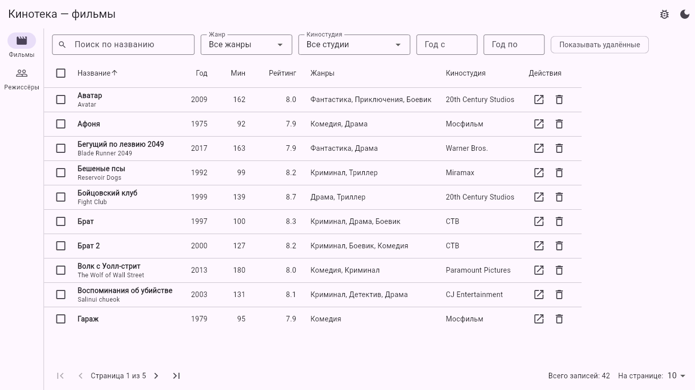
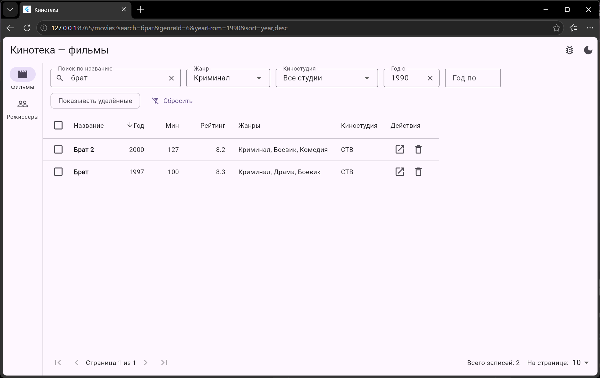
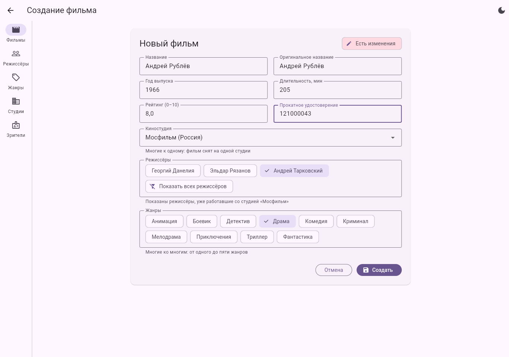
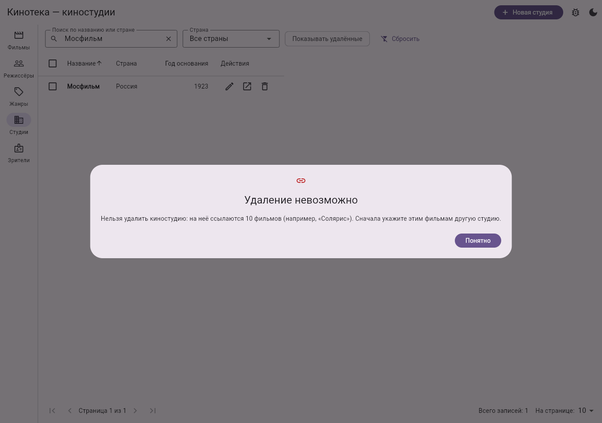
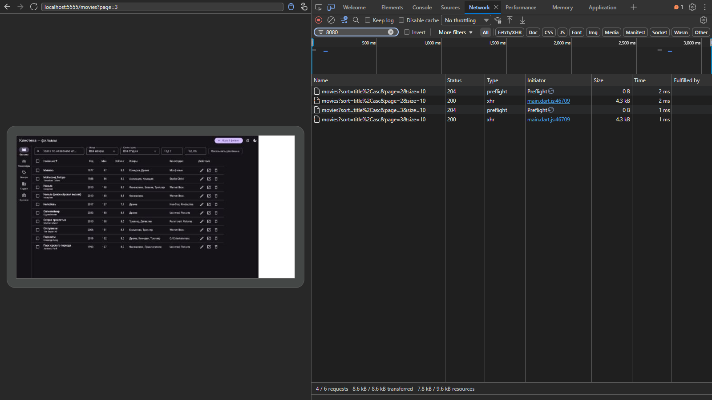
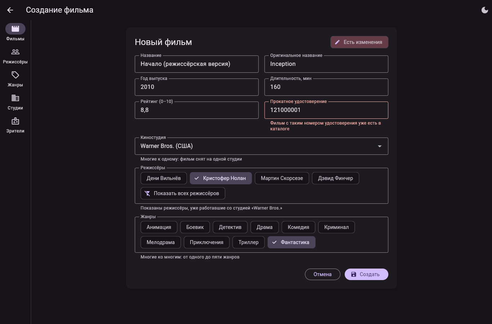
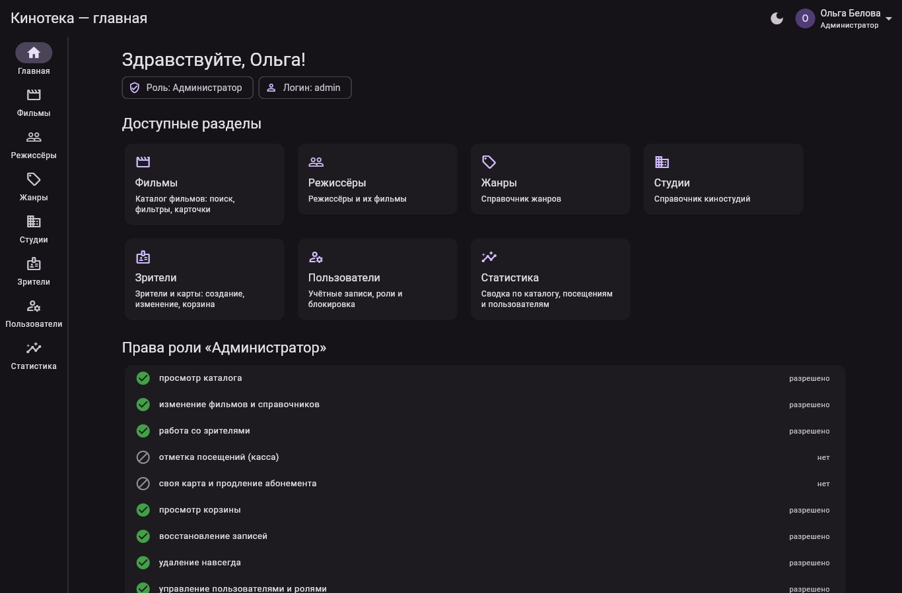
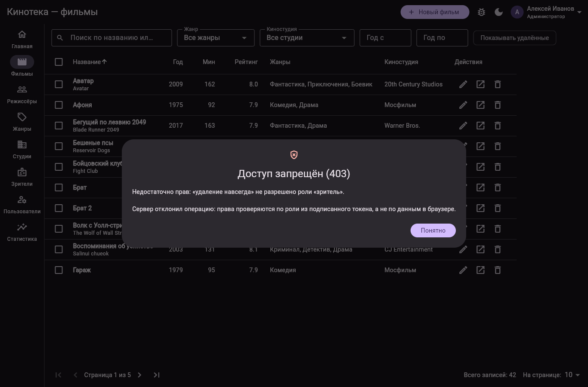
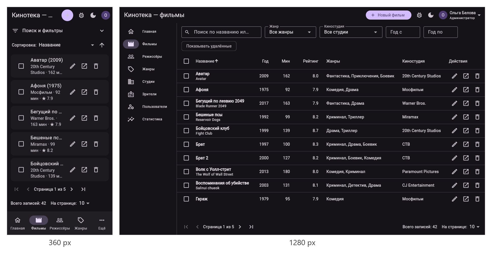

# Учебная практика УП.04.01 «Внедрение и поддержка программного обеспечения»

**Студент:** Шарапов Георгий Николаевич, группа П-3-23
**Стек:** Flutter Web, Dart, go_router, provider, shared_preferences, Dio; учебный сервер — Node.js

| Работа | Тема | Папка |
|---|---|---|
| ПР1 | Первое web-приложение: маршрутизация и параметры в URL | [`ПР1/--main`](ПР1/--main) |
| ПР2 | Списки, поиск, фильтрация и пагинация («Кинотека») | [`ПР2/kinoteka`](ПР2/kinoteka) |
| ПР3 | Формы, валидация и связанные сущности («Кинотека») | [`ПР3/kinoteka`](ПР3/kinoteka) |
| ПР4 | Подключение REST API («Кинотека») | [`ПР4/kinoteka`](ПР4/kinoteka), [`ПР4/server`](ПР4/server) |
| ПР5 | Аутентификация, роли и защита маршрутов («Кинотека») | [`ПР5/kinoteka`](ПР5/kinoteka), [`ПР5/server`](ПР5/server) |
| ПР6 | Адаптивная вёрстка, сборка, публикация и тестирование («Кинотека») | [`ПР6/kinoteka`](ПР6/kinoteka), [`ПР6/server`](ПР6/server) |

Общий отчёт по всем работам: [`Практические работы УП.docx`](Практические%20работы%20УП.docx)

---

## ПР1. Маршрутизация, формы и URL

### Цель
Создать web-приложение на Flutter из нескольких экранов, освоить маршрутизацию через адресную строку, передачу параметров через URL и прямой переход по ссылке (в том числе после перезагрузки страницы).

### Что сделано
- **Главная страница** с переходами в калькулятор и конвертер валют.
- **Калькулятор**: два числа и операция, валидация формы, результат на `/calculator/result?a=10&op=%2B&b=3`.
- **Конвертер валют**: шесть валют с константными курсами, результат на `/converter/result?from=USD&to=RUB&amount=10`.
- **Обработка ошибок**: деление на ноль и неверные параметры — экран ошибки; неизвестный адрес — экран 404.
- **Тема**: светлая/тёмная, выбор сохраняется в `shared_preferences` (localStorage браузера).
- **Тесты** логики калькулятора и конвертера.

### Маршруты
| Адрес | Экран |
|---|---|
| `/` | Главная |
| `/calculator`, `/calculator/result` | Калькулятор и результат |
| `/converter`, `/converter/result` | Конвертер и результат |
| любой другой | 404 (`errorBuilder`) |

### Запуск
```bash
cd ПР1/--main
flutter pub get
flutter run -d edge
```

### Отчёт
[`ПР1/.docx`](ПР1/.docx)

---

## ПР2. Списки, поиск, фильтрация и пагинация — «Кинотека»

### Цель
Освоить управление состоянием через `provider`, разделение приложения на слои и построение списков с поиском, фильтрацией, сортировкой и постраничным выводом. Данные хранятся в памяти: 42 фильма, 14 режиссёров, 10 жанров, 12 киностудий.



### Слои приложения
| Папка | Что внутри |
|---|---|
| `models` | `Movie`, `Director`, `PageResult<T>`, `MovieQuery`, `DirectorQuery` |
| `data` | начальный набор данных |
| `repositories` | интерфейсы `MovieRepository`, `DirectorRepository` и реализации в памяти |
| `state` | `PagedListNotifier<T, Q>` и его наследники, notifier'ы карточек |
| `screens` | списки, карточки, 404 |
| `widgets` | `EntityTable<T>`, `EntityListView<T, Q>`, `PaginationBar`, `DebouncedTextField` |

### На оценку «3»
- Две сущности — фильмы и режиссёры: модели с `copyWith`, репозитории в памяти.
- Экраны списка и карточки, переходы через `go_router`.
- Состояние через `provider`; виджеты не обращаются к репозиторию напрямую.
- Четыре состояния экрана: загрузка, данные, пустой результат, ошибка (меню «Проверка → Имитировать сбой загрузки»).
- `flutter analyze` — без замечаний.

### На оценку «4»
- **Ошибка в `deleteMany`**: в условии `!b[i].isDeleted` переменная `i` используется до объявления, а к фильму обращаются как к списку. Исправлено на `!m.isDeleted`.
- Поиск: фильмы — по названию и оригинальному названию, режиссёры — по фамилии и стране.
- Фильтры: жанр, киностудия, диапазон лет — комбинируются между собой и с поиском.
- Множественное удаление: флажки, счётчик, подтверждение.
- Удаление в корзину (`deletedAt`) и навсегда, показ удалённых, восстановление.
- Адаптивность: меньше 600 px — карточки вместо таблицы.

### На оценку «5»
- Пагинация: первая / предыдущая / следующая / последняя страницы, номер страницы, всего записей, размер 10 / 25 / 50.
- Сортировка по щелчку на заголовке (4 поля у фильмов, 4 у режиссёров) со стрелкой направления.
- Обобщённая таблица `EntityTable<T>` — общая для фильмов и режиссёров.
- Все условия в адресе: `/movies?search=брат&genreId=6&yearFrom=1990&sort=year,desc&page=2`; кнопка «назад» браузера работает.
- Поиск с задержкой 400 мс после окончания ввода.



### Проверка
- 13 автотестов (`flutter test`): пагинация, поиск, фильтры, сортировка, удаление и восстановление, сбой сети, разбор адреса.
- Все скриншоты — в [`ПР2/screenshots`](ПР2/screenshots).

### Запуск
```bash
cd ПР2/kinoteka
flutter pub get
flutter run -d edge
```
> Если в пути к проекту есть символ `=`, `flutter build web` падает на этапе dart2js — соберите копию проекта из папки с обычным путём.

### Отчёт
[`ПР2/Отчет ПР2.docx`](ПР2/Отчет%20ПР2.docx)

---

## ПР3. Формы, валидация и связанные сущности — «Кинотека»

### Цель
Добавить формы создания и изменения с многоуровневой валидацией, довести каталог до пяти сущностей со всеми типами связей и сохранять данные между перезагрузками страницы. Проект продолжает ПР2.



### Сущности и связи
| Сущность | Связи |
|---|---|
| Фильм | многие к одному с киностудией, многие ко многим с режиссёрами и жанрами |
| Режиссёр | многие ко многим с фильмами |
| Жанр | многие ко многим с фильмами |
| Киностудия | один ко многим с фильмами |
| Зритель | один к одному с картой зрителя |

Логическая и физическая схемы: [`d01_logical.png`](ПР3/screenshots/d01_logical.png), [`d02_physical.png`](ПР3/screenshots/d02_physical.png).

### На оценку «3»
- Данные хранятся в `localStorage` через `shared_preferences`, после F5 изменения на месте.
- `toJson` / `fromJson` у всех моделей; отсутствующие поля и `null` не роняют приложение.
- Формы создания и изменения; у каждого поля своя проверка: обязательность, длина, диапазон, формат почты и телефона, положительность количеств.
- Ошибки — под полями; валидаторы в отдельном файле `lib/validation/validators.dart`.

### На оценку «4»
- Пять сущностей с полным CRUD: список, карточка, создание, изменение, удаление.
- Связи в интерфейсе: выпадающий список (студия), множественный выбор чипами (режиссёры, жанры), вложенная группа полей (карта зрителя).
- Выпадающие списки заполняются из репозиториев, а не константами.
- Создание и изменение — один экран (`/movies/new` и `/movies/:id/edit`).
- Уникальность: номер прокатного удостоверения, почта и номер карты зрителя, название жанра — ошибка в поле.
- Киностудию со связанными фильмами удалить нельзя: приложение называет число фильмов.

### На оценку «5»
- Поиск, фильтры, сортировка, пагинация, корзина и восстановление — для всех пяти списков.
- Предупреждение о несохранённых изменениях: `PopScope` + `onExit` маршрута (кнопки, меню, «назад» браузера).
- Каскад: после выбора студии в списке остаются режиссёры, работавшие с ней.
- Версия формата данных: миграция `movies_v1` → `movies_v2` с сообщением пользователю; испорченные данные заменяются начальным набором.
- Общая форма `EntityForm`: поля описываются списком `FieldSpec`, разметка и отправка общие.



### Проверка
- 17 автотестов (`flutter test`), `flutter analyze` без замечаний.
- Сценарий в браузере — 22 проверки; скриншоты в [`ПР3/screenshots`](ПР3/screenshots).

### Запуск
```bash
cd ПР3/kinoteka
flutter pub get
flutter run -d edge
```

### Отчёт
[`ПР3/Отчет ПР3.docx`](ПР3/Отчет%20ПР3.docx)

---

## ПР4. Подключение REST API — «Кинотека»

### Цель
Заменить хранилище в браузере на настоящий сервер, освоить Dio в условиях web-платформы, научиться диагностировать CORS и обрабатывать все состояния сетевого слоя. Проект продолжает ПР3.



### Состав
| Папка | Что внутри |
|---|---|
| `ПР4/server` | учебный сервер `mock-server.js` (Node.js, без зависимостей) и начальный набор `seed.json` |
| `ПР4/api` | контракт API — [`КОНТРАКТ-API.md`](ПР4/api/КОНТРАКТ-API.md) |
| `ПР4/kinoteka/lib/core` | `config.dart`, `api_client.dart` (Dio и интерсепторы), `api_exceptions.dart`, `api_debug.dart` |
| `ПР4/kinoteka/lib/repositories` | `ApiRepository<T, Q>` и `Api*Repository` для пяти сущностей |

### На оценку «3»
- Списки загружаются с сервера через Dio; данные в памяти и `localStorage` больше не используются.
- Базовый адрес и таймауты (соединение 10 с, ответ 15 с); адрес — `--dart-define=API_BASE_URL=…`.
- Четыре состояния: загрузка, данные, пустой результат, ошибка с кнопкой «Повторить».
- Проверено при остановленном сервере, с `?__fail=500` и с `?__delay=1500` (в адресе страницы или в меню «Проверка»).

### На оценку «4»
- Полный CRUD через API для всех сущностей: создание, чтение, изменение, корзина, удаление навсегда, восстановление, множественное удаление.
- Собственные исключения (`NetworkException`, `ValidationException`, `ConflictException`…); в виджетах нет ни Dio, ни `DioException`.
- Интерсептор: разбор кодов 4xx и журнал `[API] метод адрес → код (время)` в консоли.
- 422 — ошибки под полями формы (номер удостоверения, почта, карта зрителя).
- 409 — понятное сообщение: посещение по карте без остатка, удаление студии со связанными фильмами.
- Ошибка CORS воспроизведена (клиент с порта 5557), найдена по консоли и журналу сервера, устранена через `--origin`.

### На оценку «5»
- Поиск, фильтры, сортировка и страницы — на сервере; клиент хранит только текущую страницу.
- Отмена устаревших запросов поиска через `CancelToken`.
- Повтор при сетевом сбое: до трёх попыток с паузой 400 и 800 мс, только для GET.
- Кэш справочников: жанры, студии, режиссёры запрашиваются один раз, после правки — только изменённая часть.
- Кнопка сохранения блокируется на время отправки; двойное нажатие не создаёт вторую запись.
- 11 модульных тестов репозитория с подменённым адаптером Dio (422, 409, недоступность сервера, повтор, отмена…).



### Проверка
- 21 автотест (`flutter test`), `flutter analyze` без замечаний.
- Сценарий в браузере — 30 проверок; скриншоты в [`ПР4/screenshots`](ПР4/screenshots).

### Запуск
```bash
cd ПР4/server
node mock-server.js --port 8080 --origin http://localhost:5555
```
```bash
cd ПР4/kinoteka
flutter pub get
flutter run -d edge --web-port=5555
```
Проверка сервера: http://localhost:8080/api/__health

### Отчёт
[`ПР4/Отчет ПР4.docx`](ПР4/Отчет%20ПР4.docx)

---

## ПР5. Аутентификация, роли и защита маршрутов — «Кинотека»

### Цель
Реализовать вход, разграничение прав по ролям и защиту маршрутов на клиенте и на практике проверить, где проходит граница между удобством интерфейса и настоящей защитой. Проект продолжает ПР4.



### Состав
| Папка | Что внутри |
|---|---|
| `ПР5/server` | сервер ПР4 + JWT (HS256), хеши паролей scrypt, роли и права, обновление и отзыв токенов, `--ttl`, `--secret` |
| `ПР5/api` | контракт API с разделом «Аутентификация (ПР5)» |
| `ПР5/kinoteka/lib/auth` | `AuthNotifier`, `AuthApi`, `InactivityWatcher`, `permissions.dart`, `password_rules.dart` |
| `ПР5/kinoteka/lib/screens` | вход, регистрация, главная, экран отказа, «Моя карта», «Касса», «Пользователи», «Статистика» |

### Роли и права
| Операция | Зритель | Менеджер | Администратор |
|---|:-:|:-:|:-:|
| просмотр каталога | + | + | + |
| изменение фильмов и справочников | — | + | + |
| работа со зрителями | — | + | + |
| отметка посещений (касса) | — | + | — |
| своя карта и продление абонемента | + | — | — |
| корзина, восстановление, удаление навсегда | — | — | + |
| пользователи и роли, статистика | — | — | + |

Учебные учётные записи: `admin / Admin#2026`, `manager / Manager#2026`, `viewer / Viewer#2026`.

### На оценку «3»
- Формы входа и регистрации с проверкой обязательных полей; ошибки сервера (401, 422) — понятным текстом.
- После входа — главный экран, в шапке имя и роль; «Выйти» удаляет токены и отзывает токен обновления.
- Токены в `shared_preferences` (localStorage): после F5 пользователь остаётся в системе.
- Все запросы к API уходят с заголовком `Authorization: Bearer …`.

### На оценку «4»
- Пароль проверяется по мере ввода: не короче 8 символов, цифра, специальный символ (то же проверяет сервер).
- Три роли с разным составом функций; у каждой есть свой раздел: «Моя карта», «Касса», «Пользователи» и «Статистика».
- Маршруты защищены через `redirect` у GoRouter: без входа — `/login?from=…`, чужой раздел — экран отказа.
- Недоступные кнопки и разделы скрыты; после входа — возврат на исходный адрес.
- Ответ 403 показывается диалогом «Доступ запрещён (403)» с текстом сервера.

### На оценку «5»
- Прозрачное обновление токена при 401 (`AuthRefreshInterceptor`), одно обновление на одновременные запросы; проверено с `--ttl 60`.
- Выход после 3 минут бездействия с предупреждением за 30 секунд; учитывается и после перезагрузки.
- Ограничение общей длительности сессии (`SESSION_MAX_MINUTES`, по умолчанию 480).
- Неудачное обновление — выход без зацикливания запросов.
- Проверка пункта 17: роль в localStorage заменена на `admin`, кнопки появились, но сервер ответил 403 — права он берёт из подписанного токена.
- 20 новых тестов: права ролей, вход, обновление токена, защита маршрутов.



### Проверка
- 41 автотест (`flutter test`), `flutter analyze` без замечаний.
- Скриншоты приложения, DevTools, PowerShell и VS Code — в [`ПР5/screenshots`](ПР5/screenshots).

### Запуск
```bash
cd ПР5/server
node mock-server.js --port 8080 --origin http://localhost:5555
```
```bash
cd ПР5/kinoteka
flutter pub get
flutter run -d edge --web-port=5555
```
Короткий срок токена для проверки обновления: `node mock-server.js --ttl 60`.
Короткие таймеры сессии: `--dart-define=INACTIVITY_SECONDS=40 --dart-define=SESSION_MAX_MINUTES=2`.

### Отчёт
[`ПР5/Отчет ПР5.docx`](ПР5/Отчет%20ПР5.docx)

---

## ПР6. Адаптивная вёрстка, сборка, публикация и тестирование — «Кинотека»

### Цель
Довести приложение до состояния, в котором его можно показать: интерфейс работает при любой ширине окна, релизная сборка опубликована, код покрыт тестами. Проект продолжает ПР5.

**Опубликованное приложение:** https://1kotleta1.github.io/YP/ (демонстрационный режим, вход `admin / Admin#2026`).
Публикацию выполняет GitHub Actions (`.github/workflows/pages.yml`); в настройках репозитория один раз выбирается **Settings → Pages → Source: GitHub Actions**.



### Ширина окна и раскладка
| Ширина | Раскладка |
|---|---|
| < 600 (360) | одна колонка, навигация снизу, списки карточками |
| 600–1023 (768) | боковая полоса навигации, карточки в две колонки |
| 1024–1599 (1280) | таблицы, развёрнутая навигация с подписями |
| ≥ 1600 (1920) | содержимое ограничено шириной 1440 px и выровнено по центру |

Границы — в `lib/core/breakpoints.dart`, раскладка перестраивается на ходу, без перезагрузки.

### Состав изменений
| Файл | Что сделано |
|---|---|
| `lib/core/breakpoints.dart` | классы ширины окна `WindowSize` и предельная ширина содержимого |
| `lib/widgets/app_shell.dart` | нижняя навигация / полоса / развёрнутая полоса, баннер «Нет связи с сервером» |
| `lib/widgets/entity_list_view.dart`, `entity_table.dart` | карточки или таблица по ширине, обрезка длинных значений, двумерная прокрутка |
| `lib/router.dart`, `lib/widgets/deferred_screen.dart` | карточки, формы и личный кабинет загружаются отложенно (`deferred as`) |
| `lib/core/server_status.dart` | опрос сервера после обрыва связи и автоматическая перезагрузка данных |
| `lib/core/config.dart`, `env/*.json` | адрес API только из параметра сборки (`--dart-define`) |
| `web/index.html` | экран-заглушка на время загрузки |
| `server/api-core.js`, `server/kinoteka-demo.js` | учебный сервер, который в демонстрационной сборке работает прямо в браузере |
| `.github/workflows/pages.yml` | автосборка и публикация на GitHub Pages |

### На оценку «3»
- Все экраны проверены при ширине 360, 768, 1280 и 1920 px: переполнений нет, консоль чистая.
- На узком окне таблицы заменяются карточками, навигация переносится вниз.
- Формы ограничены по ширине, фильтры и пагинация переносятся (`Wrap`), длинные названия обрезаются, диалоги не шире 520 px.
- Релизная сборка `flutter build web --release`; `flutter analyze` и `dart format --set-exit-if-changed` без замечаний.

### На оценку «4»
- Публикация на GitHub Pages в подкаталоге `/YP/` (`--base-href /YP/`), `404.html` — копия `index.html`: прямые ссылки и обновление страницы работают.
- Адрес API задаётся параметром сборки, в коде адресов нет; без параметра приложение показывает подсказку.
- Сравнение обычной сборки и `--wasm`: размер и время первой загрузки — в таблице ниже.
- 56 автотестов; модульные — валидаторы, разбор моделей, условия отбора, права ролей, вход и обновление токена.

### На оценку «5»
- 10 тестов виджетов: загрузка, пустой результат, ошибка с повтором, проверка формы, скрытие элементов по роли, раскладка на 360 и 1280 px.
- Размер уменьшен отложенной загрузкой редких разделов: `main.dart.js` 3 073 114 → 3 003 101 байт, формы, карточки и кабинет — в отдельных частях.
- Экран-заглушка с названием и индикатором вместо белого экрана.
- GitHub Actions: анализатор, формат, тесты, сборка и публикация при каждом изменении `ПР6/` в `main`.
- Доступность: управление с клавиатуры, видимый фокус, подсказки у всех значков.
- Без связи с сервером — баннер и понятное сообщение; после возвращения сервера данные загружаются сами, без перезагрузки страницы.

### Размер сборки и первая загрузка
| Вариант | main.dart.* | после gzip | первый кадр, localhost | первый кадр, 10 Мбит/с |
|---|---|---|---|---|
| JS до оптимизации | 3 073 114 Б | 902 КБ | ≈ 1,9 с | ≈ 2,87 с |
| JS после `deferred as` | 3 003 101 Б + 88 КБ частей | 885 КБ | ≈ 1,7 с | ≈ 2,85 с |
| WebAssembly (`--wasm`) | 2 665 056 Б | 1 001 КБ | ≈ 1,8 с | ≈ 3,24 с |

Время — медиана пяти загрузок с чистым кэшем в Edge, среднее двух серий.

### Проверка
```bash
flutter analyze
dart format --set-exit-if-changed lib test
flutter test
```

### Запуск
```bash
cd ПР6/server
node mock-server.js --port 8080 --origin http://localhost:5555
```
```bash
cd ПР6/kinoteka
flutter run -d edge --web-port=5555 --dart-define-from-file=env/local.json
```
Без сервера, в демонстрационном режиме: `--dart-define-from-file=env/demo.json` (перед этим скопировать `ПР6/server/api-core.js`, `kinoteka-demo.js` и `seed.json` в `web/demo`).

Релизная сборка для GitHub Pages:
```bash
flutter build web --release --base-href /YP/ --dart-define=API_BASE_URL=demo
cp build/web/index.html build/web/404.html
```

### Отчёт
[`ПР6/Отчет ПР6.docx`](ПР6/Отчет%20ПР6.docx)
